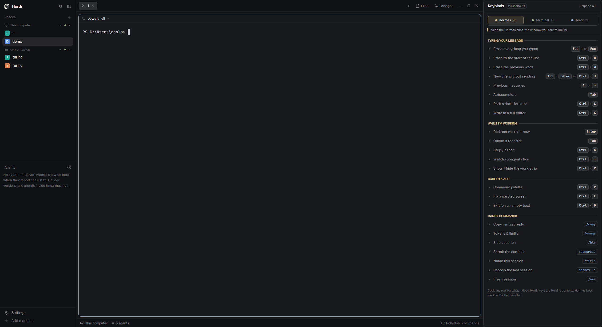

# Keybinds

A keyboard cheat sheet that lives in Herdr. It covers three places you type: the Hermes chat, a plain Linux bash shell, and the Herdr window itself. You pick one with a three-way switch at the top and get a grouped list of shortcuts, each with its keys drawn as little keycaps. Click a row and it opens a one or two sentence explanation underneath. It docks as a 420px panel on the right the first time Herdr sees it, and Ctrl+Shift+Y opens the same sheet as a dialog from anywhere.

## What you see

Top to bottom, inside one card (theme `background`, 1px `border`, 10px corners):

1. Header, 42px tall, 14px side padding, 1px `border` line under it.
   - "Keybinds" in semibold 13px `foreground`.
   - A small chip next to it: "23 shortcuts" (the count for the platform shown), 10px `muted` text, 1px `border`, 4px corners.
   - On the far right a text button, "Expand all", 11px `muted`, 24px tall, 6px corners. It turns `hover` with `foreground` text under the pointer. It reads "Collapse all" whenever at least one row of the shown platform is open.
2. Platform switch, 10px padding around it, 1px `border` line under it.
   - A segmented control: a `surface` strip with a 1px `border`, 8px corners, 3px padding and 3px gaps, holding three equal tabs 30px tall with 6px corners.
   - Each tab: a 7px dot in the platform's color, the name (12px, medium weight), then its count (10px).
   - Platforms and colors: Hermes = theme `ansi3` (yellow), 23 items. Terminal = `ansi2` (green), 18. Herdr = `ansi4` (blue), 19.
   - The chosen tab gets its color at about 15% opacity as background (hex suffix `26`), a border in its color at about 53% (`88`), `foreground` text and its count in its color. The others are `surface` with `muted` text and a `dim` count.
   - Under the strip: a 3x12px bar in the platform color, then a one-line blurb in 11px `muted`:
     - Hermes: "Inside the Hermes chat (the window you talk to me in)."
     - Terminal: "A normal Linux shell (bash) on the server."
     - Herdr: "The Herdr Desktop window on your PC (these are its default keys on Windows)."
3. The list. It fills the rest and scrolls vertically, with a thin overlay scrollbar. 6px padding (12px at the bottom), 2px between rows.
   - Group headings: the group name in UPPERCASE, 10.5px semibold in the platform color, followed by a 1px `border` line that runs to the right edge. 12px of space above every heading except the first (6px).
   - Rows: at least 32px tall, 8px side padding, 7px corners, `hover` background under the pointer. Left to right: a 12px chevron (pointing right in `dim` when closed, down in the platform color when open), the label (12.5px, `muted` when closed, `foreground` when open), then the keys, pushed right.
   - Keys: each key is a keycap 20px tall, at least 20px wide, 5px corners, 1px `border` with a 2px bottom edge so it looks pressed-in, `raised` background, 11px monospace `foreground` text (the terminal font, JetBrains Mono by default). Keys pressed together are joined by a small "+", keys pressed one after another by "then", and a second way to do the same thing follows "or". All three joiners are 10px `dim`.
   - Commands (things you type, like `/copy` or `cd -`) are drawn as one code chip instead: same shape, `surface` background, `accent` text, 7px side padding.
   - An open row gets a faint wash of the platform color (hex suffix `10`, about 6%) and, under its first line, the explanation: indented 28px, a 2px bar in the platform color on the left, then 11.5px `foreground` text with 17px line height, wrapping.
   - After the last group, a footnote in 10.5px `dim`: "Click any row for what it does. Herdr keys are Herdr's defaults; Hermes keys work in the Hermes chat."

The content, platform by platform. Labels are on the left, keys on the right. Every row also carries a short plain explanation (one or two sentences, written for someone new to terminals, e.g. for Esc Esc: "Clears the whole input box in one go, even while I'm working. Nothing is lost: press ↑ to bring it back.").

Hermes:
- Typing your message: Erase everything you typed (Esc then Esc) · Erase to the start of the line (Ctrl+U) · Erase the previous word (Ctrl+W) · New line without sending (Alt+Enter or Ctrl+J) · Previous messages (↑ or ↓) · Autocomplete (Tab) · Park a draft for later (Ctrl+S) · Write in a full editor (Ctrl+G)
- While I'm working: Redirect me right now (Enter) · Queue it for after (Tab) · Stop / cancel (Ctrl+C) · Watch subagents live (Ctrl+T) · Show / hide the work strip (Ctrl+R)
- Screen & app: Command palette (Ctrl+P) · Fix a garbled screen (Ctrl+L) · Exit (on an empty box) (Ctrl+D)
- Handy commands (code chips): Copy my last reply (/copy) · Tokens & limits (/usage) · Side question (/btw) · Shrink the context (/compress) · Name this session (/title) · Reopen the last session (hermes -c) · Fresh session (/new)

Terminal:
- Editing the command line: Jump to start / end of line (Ctrl+A or Ctrl+E) · Jump word by word (Ctrl+← or Ctrl+→) · Erase to the start (Ctrl+U) · Erase to the end (Ctrl+K) · Erase the previous word (Ctrl+W or Ctrl+Backspace) · Undo an erase (paste it back) (Ctrl+Y) · Complete names (Tab or Tab then Tab)
- History: Previous commands (↑ or ↓) · Search old commands (Ctrl+R) · Repeat the last command (!!, chip) · Reuse the last argument (Alt+.)
- Running programs: Stop the running program (Ctrl+C) · Pause a program (Ctrl+Z) · Exit the shell (Ctrl+D) · Clear the screen (Ctrl+L) · Quit a pager (q)
- Handy commands (chips): Back to the previous folder (cd -) · Find a command you ran (history | grep word)

Herdr:
- Copy & paste: Copy highlighted text (Ctrl+Shift+C) · Paste text (Ctrl+Shift+V) · Paste a screenshot (or text) (Ctrl+V) · Find in the terminal (Ctrl+Shift+F)
- Tabs & spaces: New tab (Ctrl+Shift+T) · Go to tab 1–9 (Ctrl+1…9) · Close tab (Ctrl+Shift+W) · Rename tab / space (F2 or Shift+F2) · Go to space 1–9 (Alt+1…9)
- Panes (splits): Split right / down (Ctrl+Shift+O or Ctrl+Shift+E) · Move between panes (Alt+← or Alt+→) · Zoom a pane (Ctrl+Shift+Z) · Close pane (Ctrl+Shift+X)
- Agents & window: Jump between agents (Alt+↑ or Alt+↓) · Command palette (Ctrl+Shift+P) · Show / hide the sidebar (Ctrl+Shift+B) · Switch layout (Ctrl+Shift+L) · Bigger / smaller text (Ctrl+= or Ctrl+-) · Help / settings (Ctrl+? or Ctrl+,)

## How it behaves

- It shows no agents and no agent status. Working, blocked, done and idle agents change nothing here.
- Clicking a platform tab switches the list, the chip count, the blurb and every accent to that platform's color.
- Clicking anywhere on a row's first line opens or closes its explanation. Any number can be open at once.
- "Expand all" opens every row of the shown platform; "Collapse all" closes them. Other platforms' open rows are left alone.
- The chosen platform and the set of open rows are remembered per copy and survive reloads and restarts. The first time, it starts on Hermes with everything closed.
- Ctrl+Shift+Y opens the sheet as a centered dialog, 560px wide and 80% of the window's height. Pressing it again, or Esc, or clicking outside closes it. The dialog is a separate copy, so it remembers its own platform and open rows apart from the docked panel.
- Nothing animates and nothing polls. Hover only changes backgrounds and text colors.

## Built from

- One mod, `mods/keybinds-button/`, no layout:
  - `mod.json`: `{ "place": "right", "size": 420, "title": "Keybinds", "overlay": { "kind": "dialog", "width": 560, "height": 0.8 } }`. `place`/`size` make Herdr dock one copy on the right of the shown layout the first time it sees the folder. `overlay` is what `mod.open` opens.
  - `main.js`: default-exports `class Keybinds extends View`. Imports `View, div, svg` from `gpui-kit`, `v_flex, h_flex, Scrollbar` from `gpui-base`, and only `theme` and `settings` from `herdr`. No props, no `run`, no `exec`, no `fetch`, no file access, no shared state.
  - `data.js`: exports `PLATFORMS`, an array of `{ id, name, color, blurb, groups: [{ name, items }] }`. `color` is a theme color name (`ansi3`, `ansi2`, `ansi4`). Each item is `{ id, keys, alt?, cmd?, label, desc }`. `keys` and `alt` are lists of steps, each step a list of keys pressed together: `[["Ctrl","U"]]` is Ctrl+U, `[["Esc"],["Esc"]]` is Esc then Esc. `cmd: true` draws the keys as code chips. Ids are unique across all platforms (`h-…`, `t-…`, `d-…`, `c-…`) because they are both element ids and the saved open-row keys.
  - `chevron-right.svg`, `chevron-down.svg`: Lucide chevrons (24x24 viewBox, `stroke="currentColor"`, stroke width 2), drawn with `svg("mods/keybinds-button/chevron-….svg")` so they take the text color.
- State: `localStorage` keys `platform` (an id) and `open` (a JSON array of item ids), read in `init`, written on every click.
- Tinted backgrounds are the theme color string plus a two-digit hex alpha: `color + "26"`, `color + "88"`, `color + "30"` (hovered chosen tab), `color + "10"`.
- Keycap font: `settings().font_family ?? "JetBrains Mono"`.
- `keys.json` at the repo root: `{ "global": { "ctrl-shift-y": "mod.open:keybinds-button" } }`.

## Watch out

- The list only scrolls if it sits in a `flex_1().min_h(0).relative()` box and is itself `absolute().inset_0().overflow_y_scroll()` with an id (`kb-list`). Without `min_h(0)` the column grows past the panel and nothing scrolls. The scrollbar is `Scrollbar.vertical("kb-list").absolute().inset_0()` laid over the same box.
- Every clickable element needs a unique `.id()`. Keycaps use `cap-<item id>-<n>` with a counter that runs across both `keys` and `alt`, or two copies of the same key in one row collide.
- Rows, groups and the header row are `flex_none()` so the list doesn't squash them to fit.
- Image paths are relative to `~/.config/herdr-app`, so they hard-code the folder name. Rename the folder and you must change `mods/keybinds-button/` in `main.js`.
- The alpha trick assumes `theme()` returns 6-digit `#rrggbb`. A theme color that already has alpha would end up with 10 hex digits and not parse.
- The card draws its own border and rounded corners. Docked, that is the only frame. As a dialog, Herdr draws its frame around it too, so you see a card inside a card. That is how the current build looks.
- Herdr docks the mod only the first time it sees the folder. If someone closes the docked panel, it doesn't come back by itself; Ctrl+Shift+Y still works.
- The content is static. It does not read `keys()`, so a rebound Herdr key still shows the default. The Herdr keys are Herdr's Windows defaults; the Hermes keys are the Hermes CLI's; the Terminal ones are bash/readline defaults.
- A couple of explanations mention the author's own setup (a Linux server, and a layout called sr-main with Plans and Keybinds buttons). They are kept as written.
- Ctrl+Shift+Y is not bound by Herdr's defaults. When merging `keys.json`, check the person hasn't used it, and ask before replacing it.
- `herdr-app check` writes `gpui-kit.d.ts` and `jsconfig.json` into the folder. They are not part of the mod.

## Done when

- `herdr-app check ~/.config/herdr-app/mods/keybinds-button` passes.
- Copying the folder into `mods/` docks a 420px Keybinds panel on the right of the shown layout without any layout edits.
- The header reads "Keybinds" with a "23 shortcuts" chip, and the switch shows Hermes 23, Terminal 18, Herdr 19, with Hermes chosen and yellow.
- Clicking Terminal turns the accents green, the chip reads "18 shortcuts", the blurb mentions bash, and the first group is EDITING THE COMMAND LINE.
- "Esc then Esc" draws two keycaps with "then" between them; "New line without sending" draws Alt + Enter or Ctrl + J; `/copy` draws a single accent-colored chip.
- Clicking a row turns its chevron down in the platform color and shows its explanation with a colored bar; "Expand all" changes to "Collapse all".
- Saving `main.js` (a hot reload) keeps the chosen platform and the open rows.
- With 18+ rows open the list scrolls and the last row and the footnote are reachable.
- `herdr-app do mod.open --name keybinds-button` opens a 560px dialog with the same sheet, and running it again closes it. With the `keys.json` entry merged, Ctrl+Shift+Y does the same.
